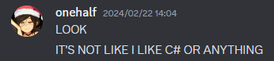
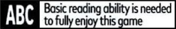
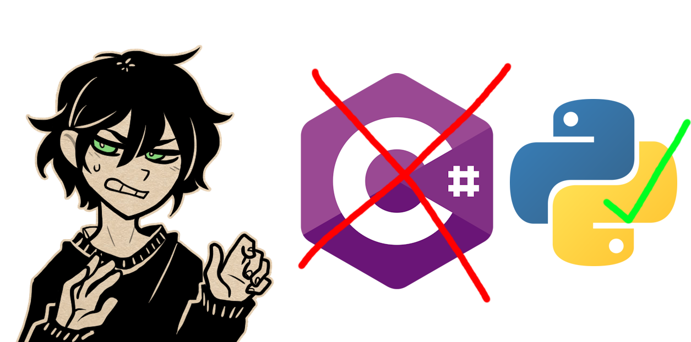

# LlamaToolkit 3.0

[](https://github.com/me-shaon/GLWTPL)



A decompilation toolkit for The Coffin of Andy and Leyley.

Works with game version 3.x (Decay), tested with game version 3.0.13.

### Prerequisites

None if running the .exe. Python 3.10+ if running from source.

### Usage



Place `LlamaToolkit.exe` in the game directory (the one containing `Game.exe`) and double-click it to open the menu. Results are saved in the game directory. If the game isn't found, you'll be asked to drag the game folder onto the window.

The commands below are for running from the command line. Pass the game directory as an argument, or run from inside it.

```
LlamaToolkit <command> [arguments]
```

Run `LlamaToolkit <command> -h` for details on any command.

### Decrypt

Decrypts images, audio and data. Encrypted files have no extension; the correct one (`.png`, `.ogg`, `.json`) is added on output. File names must be unchanged, since they are part of the key. Unencrypted files are copied as-is.

```
LlamaToolkit decrypt [input] [output]
```

`input` can be a single file, any folder (traversed recursively), or the game directory. For the game directory, only `www/audio`, `www/data` and `www/img` are processed. Defaults to the game in the current directory.

`output` defaults to `decrypted`.

### Deobfuscate

Extracts the game's hidden main script and deobfuscates it to `script_deobfuscated.js`. The game does not need to be launched or modified.

```
LlamaToolkit deob [gameDir] [-o script_deobfuscated.js]
```

To deobfuscate a script you already have, use `-f`:

```
LlamaToolkit deob -f script_obfuscated.js
```

To get the raw obfuscated script without deobfuscating it:

```
LlamaToolkit dump [gameDir] [-o script_obfuscated.js]
```

### DeDRM

Allows the game to be launched without Steam. The original `greenworks.js` is kept as `greenworks.bak`.

```
LlamaToolkit dedrm [gameDir]
```

### ReDRM

Restores the DRM.

```
LlamaToolkit redrm [gameDir]
```

### Building from source

```
pip install -e ".[dev]"
pytest
pyinstaller --onefile --name LlamaToolkit --paths src --collect-data llamatoolkit scripts/entry.py
```

Tests that need the real game look for it at `../nwjs-test-game`, or wherever `LLAMA_GAME_DIR` points, and are skipped if it is missing.

To release, set `__version__` in `src/llamatoolkit/__init__.py`, then push a matching tag (e.g. `v3.0.1`). This builds the exe and publishes a GitHub release. Start the release notes with the game version it was tested against.

The release zip ships `README.txt`, a plain-text copy of the user-facing parts of this file. Update it whenever usage changes.

### Credits

The deobfuscator uses [PyJSClear](https://github.com/intezer/PyJSClear), which is licensed under the Apache-2.0 License.


